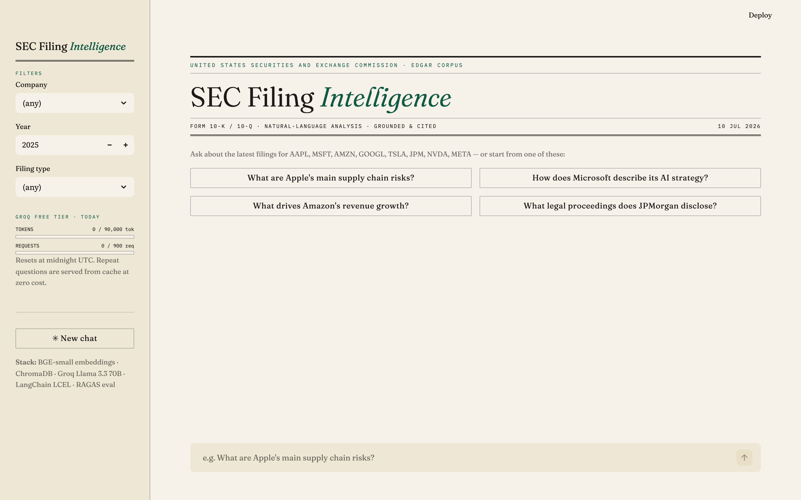
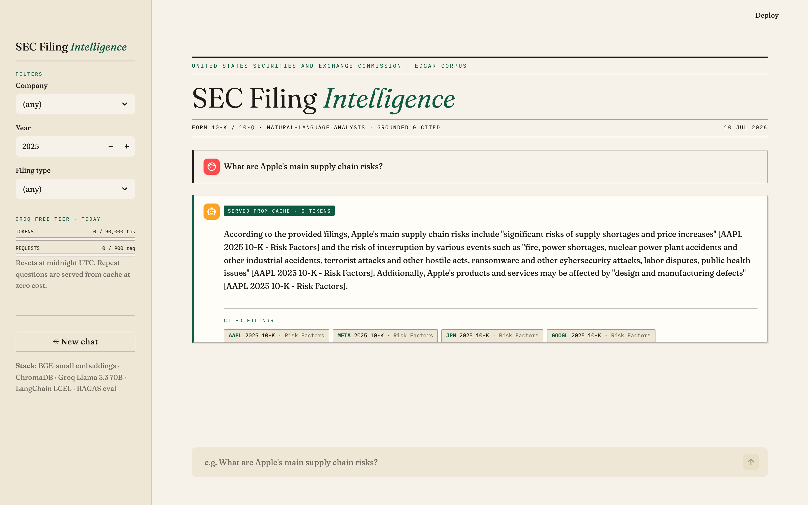

# SEC Filing Intelligence (sec-rag-intel)

> A RAG system that lets analysts query SEC 10-K filings in natural language and get
> grounded, cited answers, measured with a RAGAS evaluation harness. It's a portfolio
> project, built to run entirely on free tiers. See [Demo vs. production](#demo-vs-production)
> for what would change at scale.

[](#deployment)




*A grounded, cited answer, served from the answer cache at zero token cost, with the
free-tier budget meter live in the sidebar:*



---

## What it does
The corpus is the latest 10-K for 8 companies (AAPL, MSFT, AMZN, GOOGL, TSLA, JPM, NVDA, META).
You can ask things like:
- *"What does Tesla disclose about its supply-chain risks?"*
- *"How does Meta describe its Reality Labs operating losses?"*
- *"Which companies in the dataset call out generative AI as a material risk?"*

Answers are grounded in the filings and cite their sources, e.g.
`[AAPL 2025 10-K - Risk Factors]`. RAGAS faithfulness measures how often an answer
makes claims its sources don't support.

## Architecture
```
SEC EDGAR ──► sec-edgar-downloader ──► HTML
                                        │
                    BeautifulSoup parser (10-K Item sections)
                                        │
                          RecursiveCharacterTextSplitter
                              (480 BGE tok, 50 overlap)
                                        │
                  Local BAAI/bge-small-en-v1.5
                  (sentence-transformers, no API key)
                                        │
                  ChromaDB (local) ◄──► Pinecone (prod)
                                        │
                 Company routing ─► MMR retriever (k=5, fetch_k=20)
                 (one search per named company)  + metadata filters
                                        │
                          LangChain LCEL chain
                                        │
                Groq qwen3.8-27b  (RAGAS judge: gpt-oss-120b)
                                        │
                  Answer + Source attribution (JSON)
                          │              │
                       FastAPI       Streamlit UI
```

## Tech stack
| Layer | Tool |
|---|---|
| Data | SEC EDGAR (free) via `sec-edgar-downloader` |
| Parsing | BeautifulSoup (lxml) |
| Chunking | LangChain `RecursiveCharacterTextSplitter`, sized by the BGE tokenizer |
| Embeddings | Local `BAAI/bge-small-en-v1.5` (sentence-transformers, zero API cost) |
| Vector store | ChromaDB (local) / Pinecone (prod), toggled via `VECTOR_STORE_MODE` |
| Retrieval | Company routing + MMR with metadata filters |
| LLM | Groq `qwen/qwen3.8-27b` (RAGAS judge: `openai/gpt-oss-120b`) |
| Orchestration | LangChain LCEL |
| Evaluation | RAGAS (`faithfulness`, `answer_relevancy`, `context_recall`) |
| API | FastAPI |
| UI | Streamlit |
| Deploy | Streamlit Community Cloud |

## Quickstart

```bash
# 1. Setup
git clone <repo> sec-rag-intel && cd sec-rag-intel
python -m venv .venv && source .venv/bin/activate
make dev-install                 # requirements-dev.txt = app runtime + ingestion, eval, tests
cp .env.example .env             # then fill in GROQ_API_KEY (only key required for local dev)

# 2. Build the index (downloads filings → parses → embeds)
make index

# 3. Run it
make api      # FastAPI on http://localhost:8000
make ui       # Streamlit on http://localhost:8501

# 4. (optional) Evaluate a few questions
make eval-subset N=5             # results accumulate in eval_results/
```

## Free-tier guardrails (cost engineering)

The whole stack runs on free tiers, so Groq's quotas are treated as a production
constraint:

| Guardrail | Where | Effect |
|---|---|---|
| Daily token + request budget per model, persisted to disk | [src/chain/quota.py](src/chain/quota.py) | LLM calls stop *before* the quota is used up; the app's generator and the eval judge have separate budgets, as Groq limits are per model |
| Requests-per-minute throttle | [src/chain/quota.py](src/chain/quota.py) | Stays under Groq's per-minute limits |
| Answer cache keyed on question + filters + model | [src/chain/cache.py](src/chain/cache.py) | Repeat questions cost **0 tokens** (corpus is static, temperature 0) |
| `max_tokens` cap on every generation | [src/config.py](src/config.py) | Set to 900 to stay under Groq's 1,000 output-tokens/minute limit for the model |
| Graceful degradation | [src/chain/rag_chain.py](src/chain/rag_chain.py) | Budget spent *or* Groq error → retrieval-only excerpts + citations instead of a crash |
| Eval pre-flight check | [src/evaluation/evaluate.py](src/evaluation/evaluate.py) | Refuses a RAGAS run today's budget can't cover |

Live usage is shown in the Streamlit sidebar (budget meter) and served at `GET /quota`.

## RAGAS evaluation

The golden set is 20 questions in [src/evaluation/golden_dataset.json](src/evaluation/golden_dataset.json):
14 about a single company, plus 6 comparisons or company lists. The reference answers
were LLM-drafted from the filings, and the list questions were rewritten from quoted
filing text. The judge is `gpt-oss-120b`, a different model family from the generator,
so the model isn't grading its own answers.

**Baseline (before company routing):** [eval_results/baseline/](eval_results/baseline/)

| Questions | Faithfulness | Answer relevancy | Context recall |
|---|---|---|---|
| Single-company (14) | 0.92 | 0.83 | 0.73 |
| Multi-company (6) | 0.52 | 0.59 | 0.14 |
| **All (20)** | **0.79** | **0.74** | **0.56** |

*A few judge calls failed on free-tier rate limits. Means are over the scored questions
(17–18 of 20 per metric).*

The eval found the system's biggest weakness: questions about several companies ran one
top-5 search over the whole corpus and got chunks from whichever companies ranked highest.
Without the right context, the model filled gaps from its own training data, and
faithfulness dropped to 0.52 on those questions. **Company routing** (one search per named
company) is the fix. Its before/after run is pending.

Known remaining gap: dense retrieval ranks number-heavy table chunks low. For example,
Apple's R&D table, JPM's capital ratios and Meta's Reality Labs figures rank 4th–22nd for
their questions. Hybrid BM25 + vector retrieval is the planned fix.

## Add a new company
1. Add the ticker to `DEFAULT_TICKERS` in [src/ingest/downloader.py](src/ingest/downloader.py)
   and its name to `COMPANY_ALIASES` in [src/retrieval/retriever.py](src/retrieval/retriever.py).
2. `make index` downloads, parses, chunks and embeds it.
3. The new ticker shows up automatically in `/companies` and the Streamlit dropdown.

## Project layout
```
src/
├── ingest/         downloader, parser, chunker, manifest, quality gate
├── embeddings/     vector store factory (Chroma / Pinecone)
├── retrieval/      company routing + MMR retriever + metadata filters
├── chain/          LCEL RAG chain, prompts, quota guard, answer cache
├── evaluation/     RAGAS runner + golden Q&A dataset
└── api/            FastAPI endpoints
app/                Streamlit UI
scripts/            build_index, index_pinecone, gen_ground_truth, smoke_test_retrieval
tests/              pytest unit + integration
```

## Design decisions (interview-ready)
- **MMR over plain similarity**: reduces redundancy when several chunks repeat the same paragraph.
- **Company routing**: a top-k search over 8 companies can't serve a comparison. Routing gives each named company its own search, capped at 8 chunks to fit Groq's tokens-per-minute limit.
- **Chunks sized in the embedding model's own tokens**: bge-small embeds at most 512 tokens and silently truncates the rest, so chunk size is measured with its tokenizer, not in characters.
- **ChromaDB local + Pinecone prod**: zero infrastructure for development, and the same code runs against a managed vector DB (`VECTOR_STORE_MODE`).
- **RAGAS over manual eval**: reproducible and quantitative. Faithfulness catches hallucinations, which matter most for financial data.
- **A judge from a different model family**: `gpt-oss-120b` grades `qwen3.8-27b`, avoiding self-evaluation bias.
- **Source attribution**: SEC filings are legal documents and analysts must verify them. That's a compliance argument, not just a UX one.
- **Local BGE embeddings instead of an embeddings API**: zero recurring cost and identical vectors across runs.
- **Quota guard + answer cache**: API quotas are a real production constraint. Budgeting, throttling, caching and graceful degradation are the same patterns you'd use against a paid bill, and the app stays up in retrieval-only mode when the LLM budget is spent.

## Demo vs. production

This deployment is a single-user demo on free tiers. Here's what would change for real
traffic:

| Area | Demo today | Production |
|---|---|---|
| Chat sessions | In-process dict, lost on restart ([rag_chain.py](src/chain/rag_chain.py)) | Redis or a database keyed by user/session |
| Quota accounting | JSON file, last-writer-wins across processes ([quota.py](src/chain/quota.py)) | Atomic counters in Redis, shared across instances |
| Answer cache | JSON file on local disk ([cache.py](src/chain/cache.py)); not keyed on index version | Redis/semantic cache, invalidated when the index is rebuilt |
| Retrieval | Dense MMR + company routing | Hybrid BM25 + dense with rank fusion, plus a reranker. Fixes the table-chunk gap |
| LLM provider | Groq free tier, one model (Groq retired the previous one mid-project) | Paid tier, pinned model versions, and a fallback provider |
| Ingestion | Manual `make index`, 10-Ks only | Scheduled pipeline for new filings, plus 10-Q support (the parser only understands 10-K Items) |
| Embeddings | Model loaded inside the web process | A separate embedding service, so web workers stay small |
| Evaluation | 20 questions, run by hand within the judge's daily limit | Larger human-reviewed golden set; an eval subset gating changes in CI |
| Access | Public, no auth | Authentication, per-user rate limits, usage tracking |
| Observability | Logs + `/metrics` | Tracing (e.g. Langfuse), latency/cost dashboards, alerting |

## Deployment

The demo runs on **Streamlit Community Cloud**, deployed from this repo's `main` branch.
It uses **Pinecone** as the vector store, so the index doesn't live on the app's disk.

```bash
# 1. Pinecone: create a free account, put PINECONE_API_KEY in .env, then upload chunks
make index-pinecone           # creates the "sec-rag-intel" index if it doesn't exist

# 2. share.streamlit.io → Create app → this repo, branch main,
#    main file app/streamlit_app.py, Python 3.11. Secrets (TOML):
#      GROQ_API_KEY      = "..."
#      PINECONE_API_KEY  = "..."
#      VECTOR_STORE_MODE = "pinecone"
#      SEC_USER_AGENT    = "Your Name your@email.com"
```

Streamlit Cloud installs `requirements.txt`, which holds only what the app needs at
runtime, including CPU-only torch on Linux. Ingestion, evaluation and dev tools are in
`requirements-dev.txt`. Every push to `main` redeploys the app.

## License
MIT
